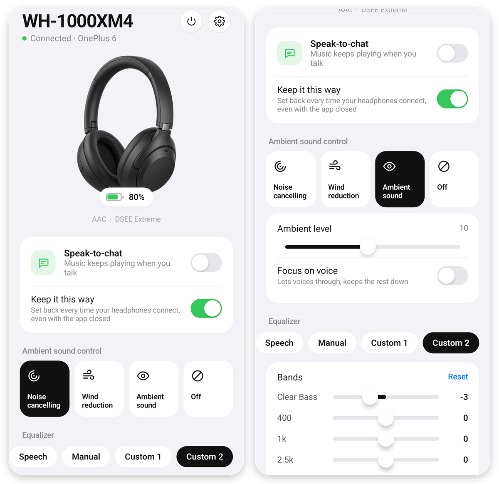
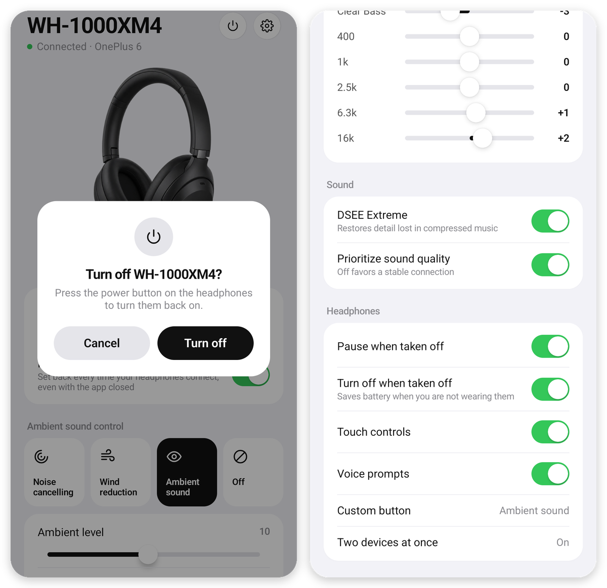
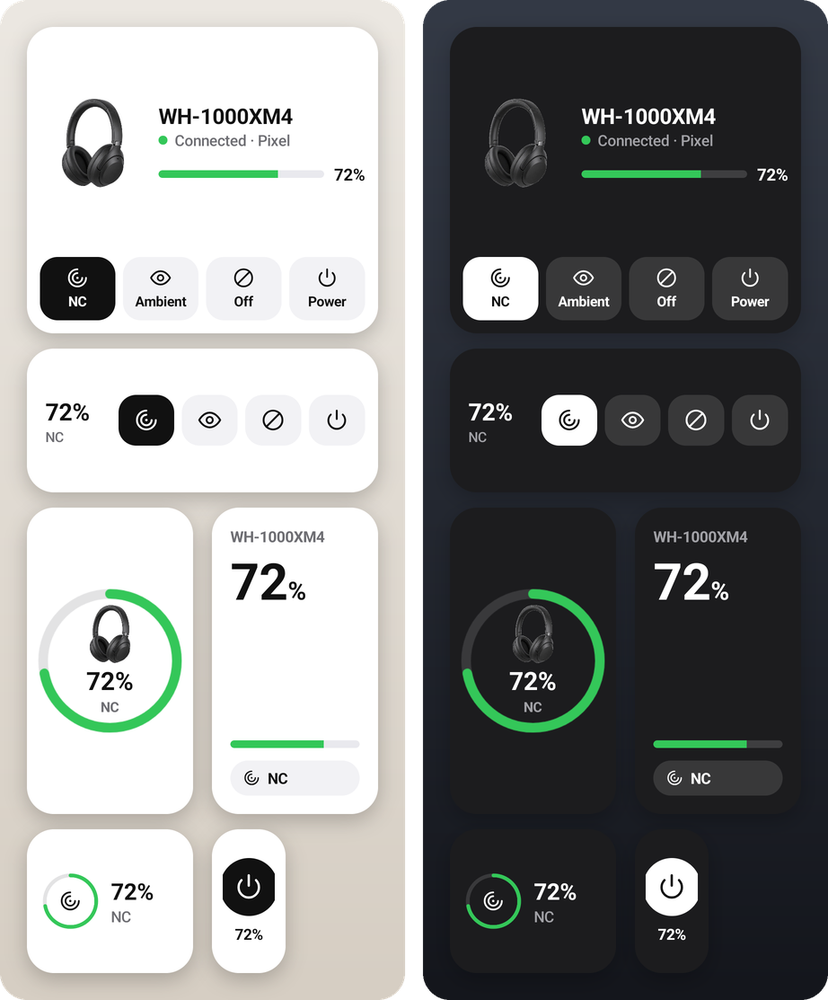

<p align="center">
  
</p>

<h1 align="center">BetterSony</h1>

<p align="center">
  A fast, quiet Android app for the Sony WH-1000XM4.<br>
  Works without a Sony account and offline.
</p>

<p align="center">
  <a href="../../releases/latest"><b>Download the APK</b></a>
</p>

<p align="center">
  
</p>
<p align="center">
  
</p>

## Why

The official Sound Connect app kept getting in the way:

- **A Sony account** just to change a setting on headphones sitting on your head.
- **Speak-to-chat kept coming back.** I want my music to keep playing when I talk, and that choice did not stick.
- **No quick way to turn them off.** Unlike headphones that sleep when you take them off, the XM4 stays on until you hold its button. Turning off Bluetooth on the phone was the easy way out, and it took my settings with it.
- **No widgets** and **no low battery warning**.

BetterSony talks to the headphones directly over Bluetooth and does only that.

## What it does

- **Keeps speak-to-chat the way you want it.** Every time the headphones connect, BetterSony checks it and sets it back, even when the app is closed. If the headphones flip it while connected, it flips it back.
- **Power off** from the app, a home screen widget or a Quick Settings tile. Works with the app closed.
- **Ambient sound control**: noise cancelling, wind reduction, ambient sound with level and focus on voice, off.
- **Speak-to-chat** options: voice detection, when music resumes, focus on voice.
- **Equalizer**: presets, Clear Bass and 5 bands for Manual, Custom 1 and Custom 2.
- **DSEE Extreme**, sound quality or stable connection, pause when taken off, turn off when taken off, touch controls, voice prompts.
- **Low battery alert** at 10, 20 or 30%, again at 10% and 5%, and each time you turn them back on while low.
- **Opens instantly** with your last known settings, then syncs in the background.
- **Seven home screen widgets** in light and dark, including a one tap power off button.

<p align="center">
  
</p>

## Install

1. Download `BetterSony-x.y.z.apk` from the [latest release](../../releases/latest).
2. Open it on your phone and allow installing from your browser or file manager.
3. Pair your headphones in Android's Bluetooth settings as usual. BetterSony finds them on its own.

Needs Android 13 or newer. The app asks for two permissions: nearby devices (to talk to the headphones) and notifications (for the battery alert). It has no internet permission at all.

## Compatibility

Built and tested on the **Sony WH-1000XM4**, firmware 3.0.1. The WH-1000XM3 speaks the same protocol and may partly work, but it has not been tested. Newer models (XM5 and later) use a different protocol and are not supported.

You can keep Sound Connect installed. Both can be connected at the same time.

## How it works

Sony headphones expose a control protocol called MDR over a standard Bluetooth serial (RFCOMM) channel. BetterSony speaks it directly: no cloud, no Sony account. Every command it sends was checked against a real WH-1000XM4 and is written up in [docs/PROTOCOL.md](docs/PROTOCOL.md).

Built with Kotlin, Jetpack Compose and Glance. Thanks to the people who mapped the protocol first: [Gadgetbridge](https://codeberg.org/Freeyourgadget/Gadgetbridge), [SonyHeadphonesClient by mos9527](https://github.com/mos9527/SonyHeadphonesClient) and [SonyHeadphonesClient by Plutoberth](https://github.com/Plutoberth/SonyHeadphonesClient).

## Build

```sh
./gradlew assembleRelease
```

Without a signing key configured (`BETTERSONY_STORE_FILE`, `BETTERSONY_STORE_PASSWORD`, `BETTERSONY_KEY_ALIAS` in `~/.gradle/gradle.properties`), the release build is signed with your debug key.

---

<sub>Not affiliated with or endorsed by Sony Group Corporation. Sony and WH-1000XM4 are trademarks of Sony Group Corporation. MIT licensed.</sub>
